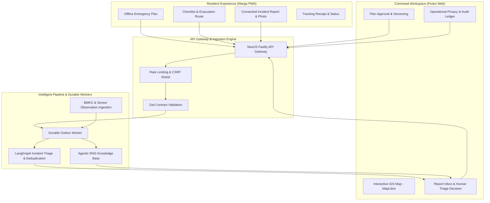

<div align="center">
  
  <h1>Tandara</h1>
  <p><strong>Community-Driven Disaster Preparedness & AI-Augmented Flood Response Platform</strong></p>
  <p><strong>Team: Mas Gudegnya Dua Soto Mienya Dua Pakai Nasi</strong></p>
  <p>
    <strong>Live Production Deployment:</strong><br/>
    <a href="https://tandara.my.id/" target="_blank"><strong>Resident Portal (Warga): https://tandara.my.id/</strong></a> • 
    <a href="https://posko.tandara.my.id/" target="_blank"><strong>Coordinator Workspace (Posko): https://posko.tandara.my.id/</strong></a>
  </p>
</div>

---

<div align="center">

### Frontend & Client Applications


### Backend & Cloud Architecture


### AI Engine & Agentic Workflows


### Reliability, Testing & Observability


</div>

---

## Executive Summary

**Tandara** is an enterprise-grade disaster preparedness and emergency response ecosystem designed specifically for flood-prone regions in Indonesia. It bridges the critical communication gap between at-risk citizens (**Warga**) and emergency post command coordinators (**Posko**).

Unlike naive chatbots or isolated dashboards, Tandara integrates:

- **Offline-First Resident PWA (Tandara Warga)**: Built for intermittent low-connectivity crisis scenarios. Residents can inspect evacuation routes, household preparation checklists, and draft incident reports with zero network connection.
- **Unified Command Center (Tandara Posko)**: Coordinator dashboard featuring interactive geospatial hazard layers (MapLibre + PostGIS), deduplication pipelines, triage tracking, and independent evacuation plan reviews.
- **AI-Augmented Decision Support & Agentic RAG**: Powered by LangGraph and bounded Retrieval-Augmented Generation (RAG). It provides intelligent triage suggestions, duplicate incident correlation, gap analysis on evacuation plans, and verified situational Q&A—all anchored to authoritative sources with strict human-in-the-loop review.
- **Privacy-by-Design Architecture**: Granular zero-knowledge receipts, consent-isolated private assistance tracking, client-side photo processing, cryptographic CSRF tokens, and tamper-evident audit logging.

> **Note**: Seeded demonstration datasets (regions, mock flood sensors, simulated reports, and sample organizations) represent realistic synthetic data for testing and jury evaluation.

---

## Key Innovation & Architectural Highlights



### 1. Dual-Portal Workflow

- **Warga PWA (Port 8080)**: Native offline caching via Service Worker & IndexedDB. Pre-configured demo credentials or anonymous report submission with private tracking tokens.
- **Posko Command Web (Port 8081)**: Role-Based Access Control (RBAC) separating field coordinators from cross-region administrators.

### 2. Multi-Agent & RAG Decision Engine

- **LangGraph Workflows**: Orchestrates structured report categorization, severity estimation, and landmark grounding without hallucinated emergency instructions.
- **pgvector & Hybrid Semantic Search**: Embeddings match historical flood contingency manuals and government SOPs to support coordinator actions.
- **Cost & Budget Guards**: Daily and monthly token expenditure quotas strictly enforced at the database level.
- **Explainable Deduplication**: Links related reports reversibly with coordinator attribution, preserving raw citizen submissions.

### 3. Resilient Data Layer

- **PostgreSQL 16 + PostGIS**: Geospatial queries, spatial distance calculations, and outbox event queues.
- **Zero-Data Loss Offline Sync**: Idempotent client sync keys prevent duplicate submissions during network flapping.

---

## Quick Start (One-Click Setup via Docker Compose)

The fastest and most reliable way to evaluate the entire system is with Docker Compose.

### Prerequisites

- [Docker Desktop](https://www.docker.com/products/docker-desktop/) (with Linux container engine active)
- Available ports: `8080` (Warga), `8081` (Posko)

### 1. Clone & Configure Environment

```bash
git clone https://github.com/HusniAbdillah/tandara.git
cd tandara

# Copy sample environment configuration
cp .env.example .env
```

_(On Windows PowerShell: `Copy-Item .env.example .env`)_

> Default passwords in `.env.example` are pre-configured for local evaluation. You can customize `POSTGRES_PASSWORD` and `DEMO_PASSWORD` if desired.

### 2. Build & Launch Containers

```bash
docker compose up --build -d --wait
```

This single command automatically:

1. Provisions PostgreSQL with PostGIS extensions.
2. Applies all database schema migrations.
3. Seeds comprehensive demonstration scenarios (Ciliwung River Basin, Semarang Coastal Region, synthetic sensors, verified plans, and sample reports).
4. Boots the high-performance NestJS Fastify backend and durable outbox background worker.
5. Serves both Warga and Posko frontend applications.

### 3. Verify Health

Open your browser or run:

- Health check: [http://127.0.0.1:8080/ready](http://127.0.0.1:8080/ready) (Returns `{"status":"ok"}`)
- OpenAPI Documentation: [http://127.0.0.1:8080/api/v1/system/openapi.json](http://127.0.0.1:8080/api/v1/system/openapi.json)

---

## Demo & Evaluation Access

| Portal            | Target URL                                                                      | Description                           | Default Credentials                                                                  |
| :---------------- | :------------------------------------------------------------------------------ | :------------------------------------ | :----------------------------------------------------------------------------------- |
| **Tandara Warga** | [https://tandara.my.id/](https://tandara.my.id/) _(Local: `:8080`)_             | Resident PWA (Mobile / Desktop)       | Phone: `081234560001`<br/>Password: `TandaraDemo2026!` _(Prefilled on login screen)_ |
| **Tandara Posko** | [https://posko.tandara.my.id/](https://posko.tandara.my.id/) _(Local: `:8081`)_ | Coordinator / Admin Dashboard         | Email: `ciliwung@demo.tandara.test`<br/>Password: `TandaraDemo2026!`                 |
| **System Admin**  | [https://posko.tandara.my.id/](https://posko.tandara.my.id/) _(Local: `:8081`)_ | Cross-Region Administrator & Reviewer | Email: `admin@demo.tandara.test`<br/>Password: `TandaraDemo2026!`                    |

---

## Jury Walkthrough & Demonstration Guide

To experience the full end-to-end impact in 5–10 minutes, open two separate browser windows (e.g., standard window for Warga, incognito window for Posko):

```
1. Resident Submits Report (Warga PWA - 8080)
   ├── Login with prefilled demo credentials or use as Guest.
   ├── Navigate to "Buat Laporan" (Submit Report).
   ├── Enter description: "Air naik 60cm di depan Balai Warga RT 04".
   ├── Attach photo or landmark reference and submit.
   └── Retain the confidential receipt token in "Laporan Saya".

2. Coordinator Evaluates Incident (Posko - 8081)
   ├── Log in as `ciliwung@demo.tandara.test`.
   ├── In "Kotak Laporan", view incoming resident report.
   ├── Review AI Triage suggestions: Category, Estimated Severity, Extracted Entities.
   ├── Accept or adjust triage status with one-click audit tracking.
   └── Check duplicate linking engine correlating adjacent citizen reports.

3. Offline Resilience Test (Warga PWA - 8080)
   ├── Open Developer Tools (F12) -> Network tab -> Select "Offline".
   ├── Reload page: Offline preparedness plan and checklists remain fully accessible.
   ├── Draft a new report offline (stored securely in client IndexedDB).
   ├── Toggle Network back to "Online".
   └── Watch the report automatically synchronize with verified idempotent server receipt!

4. Independent Evacuation Plan Governance (Posko - 8081)
   ├── Coordinator drafts a localized flood advisory plan update.
   ├── Separation of duties: Coordinator cannot self-approve.
   ├── Log in as `admin@demo.tandara.test` in second tab to review diff and authorize.
   └── Authorized plan propagates immediately to Warga offline storage.
```

---

## Activating Real AI Models (Optional)

By default, Tandara runs in **Deterministic / Heuristic Simulation Mode**, guaranteeing complete functionality offline without third-party API dependencies.

To enable live LLM inference and embeddings with **DeepSeek**, **Vikey**, or any OpenAI-compatible provider:

1. Open `.env`:
   ```bash
   AI_MODE=compatible
   AI_PROVIDER=deepseek           # Or 'vikey', 'openai'
   AI_MODEL=deepseek-chat         # Or target model ID
   AI_API_KEY=your_actual_api_key_here
   AI_EMBEDDING_MODE=enabled
   AI_EMBEDDING_PROVIDER=vikey
   AI_EMBEDDING_API_KEY=your_actual_api_key_here
   ```
2. Hot-reload the services:
   ```bash
   docker compose up -d --force-recreate api worker
   ```
3. Test integration:
   ```bash
   pnpm ai:verify
   ```

---

## Local Development Workflow

For developers wishing to run services outside Docker containers:

### Prerequisites

- Node.js `22.22.0` - `24.x` (Recommended: `24.20.0`)
- pnpm `10.26.2`

### Setup & Dev Server

```bash
# 1. Install dependencies across monorepo workspaces
pnpm install --frozen-lockfile

# 2. Spin up isolated development PostgreSQL container
pnpm infra:up

# 3. Execute schema migrations and seed data
pnpm db:migrate
pnpm db:seed

# 4. Start all applications concurrently (API :3000, Warga :5173, Posko :5174)
pnpm dev
```

### Quality Assurance & Automated Testing

```bash
# Run code formatting checks
pnpm format:check

# Run TypeScript typechecks & linter
pnpm typecheck
pnpm lint

# Execute integration tests
pnpm test:integration

# Execute end-to-end browser tests
pnpm test:e2e
```

---

## Repository Architecture

```
tandara/
├── apps/
│   ├── api/                   # Fastify-powered NestJS core API & OpenAPI specs
│   ├── coordinator-web/       # Tandara Posko: Command workspace & GIS dashboard (React 19)
│   ├── resident-web/          # Tandara Warga: Offline-first resident PWA (React 19 + PWA)
│   └── worker/                # Background outbox processor, scheduled tasks & alerts
├── packages/
│   ├── backend/               # Domain services, LangGraph triage agent, RAG pipelines
│   ├── contracts/             # Shared TypeScript schemas & strict Zod runtime validators
│   ├── database/              # Kysely query builders, PostGIS schema migrations & seeds
│   ├── api-client/            # Type-safe auto-generated HTTP SDK
│   └── ui/                    # Shared component library & design system
├── infrastructure/
│   ├── compose/               # Docker Compose development and testing environments
│   ├── deployment/            # Production deployment scripts & configs (Tencent / Vercel)
│   └── postgres/              # Custom PostGIS Docker build recipes
├── tooling/                   # Performance benchmarks, backup automation, AI verification
└── docs/                      # Architectural specs, security models, demo guides & runbooks
```

---

## Security & Privacy Commitments

- **No Public Secret Leakage**: Zero hardcoded secrets; continuous GitGuardian scanning in CI.
- **Strict Network Isolation**: Internal database and worker networks are not exposed to public routing.
- **Anonymized Receipts**: Residents can track and verify report progress without revealing phone numbers or personally identifiable information (PII).
- **Audit Immutability**: All coordinator actions, plan approvals, and status transitions generate immutable audit trail records.

---

<div align="center">
  <p>Built for resilient, community-first disaster response.</p>
  <p>© 2026 Mas Gudegnya Dua Soto Mienya Dua Pakai Nasi. All demonstration data is strictly for simulation purposes.</p>
</div>
