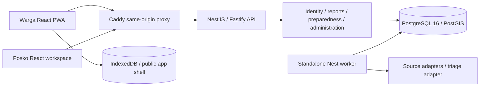

# Implemented architecture

Updated 2026-10-13. Preserves the repository's nine-package pnpm/Turbo structure;
business operations are implemented in `packages/backend/src/modules`.

## Boundaries

`contracts` owns browser-safe Zod DTOs; `api-client` implements bounded fetch,
cookie/CSRF transport and response validation. `ui` owns presentation, CSS tokens,
icons and shared accessible fields. API and worker are deployment entry points,
sharing backend services rather than importing one another. Database migration
and seed are separate executable commands. ESLint and `check-boundaries.mjs`
enforce the acyclic package graph and forbid server imports in browser packages.

Controllers authenticate the session and select receipt/public/scoped operations.
Services validate strict inputs, enforce membership and region/organization
invariants, perform parameterized SQL, apply transition policies and record audit
events inside write transactions. Authorization is evaluated from current database
membership on each request. The frontend never supplies a trusted user/role.

## Persistence and concurrency

Nine migrations create extensions, product tables, workload indexes, AI/retrieval/governance controls and public-warning provenance. UUID primary keys,
foreign keys, scoped composite constraints and indexes protect relationships.
Report inputs are separate from review decisions, AI suggestions, duplicate
relationships, private contact details, processed attachments and public summaries.
Published plan snapshots are immutable; approval requires a different person from
the author and publication archives the previous published version atomically.

Report acceptance acquires a transaction advisory lock on the UUID idempotency
key, compares the payload fingerprint and receipt-secret hash on replay, then
inserts report/history/audit/triage job/notification together. Exact retry returns
the original receipt. Changed payload under the same key returns 409. Review uses
row locking and revision checks; plans use version allocation locking and stale
edit checks. Training completion keys are similarly locked and bound to the
scenario, answers and feedback.

SQL outbox jobs use `FOR UPDATE SKIP LOCKED`, bounded attempts with exponential
backoff, two-minute abandoned-lease recovery and idempotent triage markers. The
worker schedules CAP warnings every two minutes, other enabled sources every thirty minutes and retention daily. Worker
health is a real database heartbeat. Source failures retain previous successful
timestamps and information, and do not block unrelated sources or reporting.
Redis is not required by this implementation.

## Geospatial behavior

Regions use WGS84 PostGIS polygons and spatial indexes. Coordinates require
`ST_Covers` membership in the selected region. Duplicate hints use geography
distance in meters (250 m), a one-hour observation window and category/text
similarity. Unknown coordinates/timestamps do not satisfy spatial evidence.

Coverage intersects four extent quadrants with the actual region polygon and
counts sufficiently recent, located reports. It explicitly represents
`insufficient_information`; no cell is labelled safe. MapLibre clusters located
reports and displays boundary, coverage and local points over an attributed
OpenStreetMap street basemap. Public runtime configuration selects/disables the
tile provider; CSP permits the exact default host. Tile outages retain local
layers and show an explicit warning. A textual report list remains available if
WebGL fails. There is no offline tile download or background tile sweep.

## AI and source separation

Triage adapters support disabled, deterministic heuristic, and server-side
OpenAI-compatible inference. Results require a strict schema, quoted evidence
present verbatim in the source, matching report references and human-review flags.
Invalid output is stored as failed, not a verification decision. Accept/edit/reject
records a separate human decision and never mutates the original report. A
deterministic report-group summary exposes its exact bounded sample references.

Governed LangGraph workflows also provide private briefings, drafting, translation
and evidence-grounded knowledge retrieval. PostgreSQL checkpoints, pgvector/RLS,
fenced leases, budget/release controls and immutable reviews are implemented;
production activation still requires the external gates in [AI readiness](ai/readiness.md).

Fixture, BMKG weather/CAP warnings and PetaBencana adapters normalize provenance independently.
URLs for network adapters are fixed/validated; responses have timeout, redirect
and size limits. No external source is rebranded as an official Tandara alert.
InaRISK remains a disclosed reference-only adapter. Live sources require both
deployment permission and explicit source authorization. See integration notes.

CAP retains issuance/effective/expiry and Actual/Public status, excludes cancelled/
superseded versions and matches polygons against region boundaries with PostGIS.
PetaBencana points also require regional intersection; publication time does not
become observation time. The public DTO exposes minimal source health separately
from page-load time. Source failures preserve timestamps and do not extend expiry.
See [public-source operations](operations/public-sources.md).

## Offline and media

Only the Warga app shell is precached. API responses, Posko pages, contacts, GPS
and photos are never service-worker cached. Residents explicitly save a published
plan in IndexedDB; cached views expose saved timestamps and stale/expiry notices.
Checklist progress is device-local. Consented non-sensitive text drafts use stable
keys, explicit pending states, a multi-tab navigator lock and at most five automatic
attempts. Receipts are persisted only after server acknowledgement. Offline drafts
expire after seven days. Private-contact/GPS online submissions use memory-only
retries; closing before acknowledgement has a disclosed recovery limitation.

JPEG/PNG uploads are bounded, signature checked and decoded with a pixel limit.
Sharp rotates/resizes and re-encodes JPEG without EXIF. Up to three processed
photos per report are private database bytes, fetched only through scoped,
audited access. For larger deployments, move bytes behind a private object-storage
adapter without changing receipt/authorization policy.

See [security](security/model.md), [operations](operations/runbook.md),
[offline specification](features/offline-sync.md), and
[API reference](api/openapi.json) for operating details.
