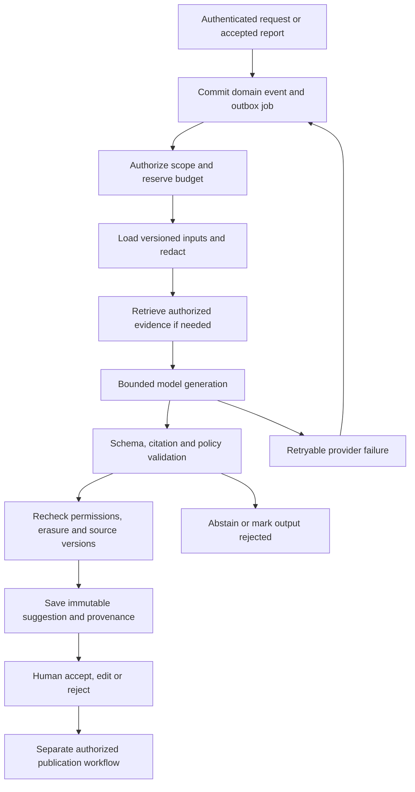

# Tandara AI: production delivery plan

Date: 2026-10-13. Status: proposed implementation specification, not a claim of deployed capability.

The delivery target is one complete production release of the AI-assisted community preparedness product. All capabilities, security controls, operating procedures, and release evidence below belong to that release. The work packages describe implementation dependencies, not a reduced MVP or a promise to finish operational controls later. Production deployment still uses controlled rollout and rollback.

## 1. Architecture decision

Use TypeScript within the existing NestJS modular monolith and separate worker. Use LangGraph for explicitly bounded workflows, selected LangChain model integrations behind Tandara-owned interfaces, Zod contracts, and PostgreSQL for jobs, checkpoints, domain records, and retrieval. Preserve PostGIS as the authority for spatial calculations. Add pgvector for semantic retrieval alongside lexical search.

This expands the previous single-call recommendation because the requested delivery now includes report assistance, evidence-backed briefings, approved-plan retrieval, translations, durable execution, and operational governance. A framework does not establish accuracy or production readiness.

LangGraph supports persisted execution state and paused workflows. Use a PostgreSQL checkpointer, not an in-memory production checkpointer. Human review remains an authenticated Tandara domain operation; a graph continuation cannot replace authorization or publication rules. [LangGraph persistence](https://docs.langchain.com/oss/javascript/langgraph/persistence), [interrupts](https://docs.langchain.com/oss/javascript/langgraph/interrupts).

The SQL outbox owns dispatch, scheduling, admission, leases, and retry timing. LangGraph owns workflow state and completed-node checkpoints. Tandara domain tables own suggestions, evidence, human decisions, and publication. Do not introduce a second independent queue or a separate agent server. Disable automatic SDK retries; the application owns a single bounded attempt budget.

| Component                             | Production responsibility                                                                                  |
| ------------------------------------- | ---------------------------------------------------------------------------------------------------------- |
| Warga and Posko React apps            | Accessible workflows, provenance, processing states, explicit human decisions                              |
| NestJS API                            | Authentication, region authorization, schema validation, idempotent job submission, review and publication |
| SQL outbox and AI workers             | Fair dispatch, quotas, provider calls, bounded graph execution, checkpoints, recovery                      |
| Tandara model gateway                 | Approved providers, credentials, model capabilities, token limits, timeouts, usage accounting              |
| PostgreSQL, PostGIS, pgvector         | Authoritative records, spatial evidence, hybrid retrieval, checkpoints, audit, retention                   |
| Private object storage                | Protected media and approved knowledge imports, with malware checks and scoped access                      |
| OpenTelemetry and operator monitoring | Content-free traces, service metrics, alerts, incident investigation                                       |

Keep the existing `AiAdapter` contract as a compatibility boundary while splitting the growing implementation into cohesive modules. Add typed interfaces for structured generation and embeddings. Use provider SDKs where necessary; do not assume every provider implements the current chat-completions payload identically. Pin and test maintained dependency versions during implementation.

## 2. Complete product scope

| Capability               | Delivered behavior                                                                                                                      | Evidence and decision boundary                                                                                              |
| ------------------------ | --------------------------------------------------------------------------------------------------------------------------------------- | --------------------------------------------------------------------------------------------------------------------------- |
| Individual report triage | Suggested category, explicit facts, missing or contradictory information, concise Indonesian summary, suggested clarification questions | Every factual claim links to report evidence; unknowns remain unknown; category can be undetermined                         |
| Duplicate assistance     | Candidate pairs plus similarities and differences, including observation time and location limitations                                  | SQL/PostGIS candidate generation first; optional model explanation; link/dismiss/undo requires a human                      |
| Operational briefings    | Region/time-scoped report digest, reviewed versus unreviewed observations, conflicts, unresolved questions, source freshness            | Deterministic counts over the complete authorized selection; generated prose cites bounded inputs and discloses omissions   |
| Approved-plan assistant  | Answers and navigation into current approved local plans and authorized preparedness documents                                          | Region-scoped retrieval, plan version and section citations, explicit abstention when evidence is insufficient              |
| Drafting assistance      | Draft clarification text, reviewed-report summaries, plan changes, and training material from approved sources                          | Drafts remain separate; no automatic message, report verification, plan approval, or publication                            |
| Translation              | Source text beside suggested Indonesian or enabled regional-language translation                                                        | Preserve dates, names, negation, units, qualifiers, and attribution; critical translations require qualified human review   |
| Coverage explanation     | Explain calculated observation gaps and propose questions for coordinators to investigate                                               | PostGIS computes coverage; model cannot infer safety, flood severity, live conditions, or a safe route from missing reports |
| AI administration        | Provider status, version releases, organization budgets, queues, failures, quality trends, permissioned retry, kill switches            | Changes and reviews are auditable; secrets are never displayed or editable through arbitrary endpoint fields                |

For Warga, serve approved plans, deterministic source navigation, and extracted approved passages. Generated paraphrases remain coordinator-facing drafts until reviewed. This gives residents reliable access to approved content without publishing an unreviewed model response as preparedness guidance.

The complete release does not enable autonomous emergency warnings, rescue dispatch, live flood prediction, route safety certification, destructive report merging, or learning from resident reports without a separately approved data program. Those are different products and responsibilities.

## 3. Workflows and output contracts

Define separate contracts for triage, duplicate explanations, briefings, answers, translations, and drafts rather than placing everything in an untyped JSON blob. All outputs carry input references, evidence references, source versions, workflow version, schema version, model release, generation time, freshness state, and provisional status.

Factual outputs use claim objects with references to allowed source spans. Validate source membership, exact supporting quotations, authorized scope, numerical consistency, and source lifecycle. Render citation links from server-owned metadata, not model-invented URLs. Do not stream unvalidated generated text into operational screens; streaming may communicate progress only.

Use explicit states such as `explicit`, `ambiguous`, `contradicted`, and `insufficient_evidence`. Never display a confidence percentage derived from the model's self-assessment. A schema-valid response and a cited passage do not prove that a claim is supported: human assessment and evaluation remain necessary.

Workflows are predefined code paths with bounded retrieval, context size, model calls, and output length. Default triage uses one generation call. Permit at most one narrowly scoped regeneration for a repairable schema failure, within the same total deadline and budget. Persist all attempt metadata. A second model may be used for measured quality checks; it is never the sole safety authority.

Model-facing operations are read-only and return scoped data. No raw SQL, arbitrary network fetch, shell execution, browser browsing, messaging, or publication tool is exposed to the model. Application code, rather than model-selected identifiers, determines region and access scope.

## 4. Knowledge and retrieval

Index only an explicitly approved corpus: published plan versions, authorized preparedness references, and appropriately labelled authorized source records. Keep private operational evidence in a separate retrieval scope from public plans. A draft, expired plan, simulation record, or unreviewed report cannot enter the resident-facing approved corpus.

Each chunk records organization, region, visibility, source entity/version, section, content hash, effective/expiry times, ingestion status, embedding model/version, and deletion state. Build embeddings from approved minimal text under the same provider data policy as generation. Treat embeddings as potentially sensitive derived data.

Use PostgreSQL lexical search with Indonesian-appropriate tokenization and pgvector similarity, combine rankings, then apply a bounded reranking step where evaluation justifies it. Begin with exact vector retrieval for small region-scoped corpora; add approximate indexes only after testing filtered recall and latency. pgvector supports vector search within PostgreSQL. [pgvector documentation](https://github.com/pgvector/pgvector).

Apply organization, region, visibility, publication, and expiry filters within retrieval queries. Add row-level security for AI-owned records and retrieval using non-owner service roles, transaction-local scope, and pool-isolation tests. Background workers use explicit authorized scope, not unrestricted user-visible retrieval. Table owners and roles with bypass privileges require separate treatment. [PostgreSQL row security](https://www.postgresql.org/docs/current/ddl-rowsecurity.html).

Publish a new index generation atomically only after ingestion validation. Never mix embedding dimensions or releases in one search. Reindexing failure leaves the last valid corpus available with an honest freshness indication. Check source state again before displaying an answer; retract derived content when its source expires, is withdrawn, or is erased.

Approved plan routes are historical approved instructions, not evidence that a route is safe now. The assistant can cite the plan and its limitations; it cannot certify present safety. Unsupported answers abstain and link to applicable approved material or configured contacts. Do not invent contacts or imply delivery to emergency services.

## 5. Domain persistence and migrations

Introduce versioned migrations rather than editing already-applied migrations. Proposed entities:

| Entity                                       | Purpose                                                                                                    |
| -------------------------------------------- | ---------------------------------------------------------------------------------------------------------- |
| `ai_runs`                                    | Authorized scope, workflow, input fingerprint, release versions, state, deadline, cancellation, dedupe key |
| `ai_attempts`                                | Provider attempt, error classification, timing, token usage, cost, external request reference              |
| `ai_outputs`                                 | Immutable validated output, source snapshot references, provenance, supersession and visibility            |
| `ai_reviews`                                 | Append-only accept/edit/reject decisions, edited content, reviewer, reason, previous decision              |
| `ai_model_releases`                          | Immutable provider/model/prompt/schema/retrieval configuration and evaluation references                   |
| `ai_budget_reservations`                     | Atomic organization/task admission, reserved usage, reconciliation and expiry                              |
| `knowledge_documents` and `knowledge_chunks` | Corpus lifecycle, scoped text, citations, embeddings and source versions                                   |
| `ai_output_sources`                          | Dependencies for withdrawal, freshness checks, privacy erasure and source review                           |
| Graph checkpoint schema                      | Resumable workflow state with scope mapping and retention ownership                                        |

Extend outbox kinds and run states using database invariants. Distinguish queued, processing, delayed retry, ready for review, unavailable, invalid, cancelled, expired, and completed. Processing state and human review state are different concepts.

Backfill existing suggestions without pretending their original model output is recoverable after past edits. Flag such legacy provenance limitations. Future edits create review revisions and never overwrite generated output. Regeneration creates a new run and cannot replace an accepted human decision silently.

Use unique logical output keys, input hashes, and generation fencing tokens. Recheck report erasure and source changes before commit. Store checkpoints and intermediate content with explicit retention; minimize them rather than duplicating full reports across nodes. Migrations must support rolling application deployment, checkpoint version compatibility, and safe rollback.

## 6. Execution reliability and cost control

Retain SQL dispatch but strengthen leases with worker identity, renewable lease expiry, and fencing. A stale worker cannot finalize after another worker takes over. Heartbeats identify each worker; a shared `primary` heartbeat does not establish health of all replicas.

Classify failures: retry network timeouts, selected transient server failures, and provider rate limits respecting `Retry-After`; do not automatically retry rejected authorization, unsupported schemas, invalid configuration, or policy failures. Default maximum is three provider attempts per run, with jitter and a shared deadline. A manual retry creates a linked run and requires authorization.

Put retry timing in the outbox. Graph nodes return typed failure states and resume from valid checkpoints; do not multiply attempts through SDK, graph, and outbox retries. Pause long human waits without holding a worker lease. The existing domain review path normally completes the generation graph; only workflows genuinely requiring further computation resume it through a new authorized outbox event.

At-least-once execution plus idempotent domain writes prevents duplicate visible suggestions. It does not guarantee exactly-once external calls or billing: a crash after a provider response can cause a repeated paid request. Use provider idempotency where supported, persist attempt/checkpoint results, and reserve for worst-case retries.

Allocate fair organization and task queues with separate limits for ingestion, triage, interactive answers, briefings, and maintenance. Apply backpressure, max queue age, bounded input size, concurrency caps, and atomic budget reservation before dispatch. Circuit breakers isolate provider outages. Provider fallback is permitted only to already approved and evaluated providers under the same data policy; every fallback is recorded.

Track provider-reported usage and reconcile it with billing. Label estimated usage when provider reporting is unavailable. Budgets apply to generation, embeddings, reranking, retries, and shadow evaluations. Configure organization and global daily/monthly caps, maximum per-run cost, and configurable warnings at 50%, 80%, and 95%. Hard limits stop new AI requests gracefully without blocking report submission or human work.

## 7. Security, privacy, and governance

Use defense in depth against direct and retrieved prompt injection. Separation of instructions and data, strict contracts, least-privilege operations, scoped retrieval, safe rendering, and human decision controls reduce impact; no prompt or keyword detector guarantees prevention. Include multilingual and indirect injection tests. [OWASP prompt injection guidance](https://genai.owasp.org/llmrisk/llm01-prompt-injection/).

Production controls include:

- Managed credentials and rotation; approved endpoint allowlists, egress controls, HTTPS, SSRF protection, and restrictions on redirects/private addresses appropriate to the deployment.
- Minimal model inputs; exclude contacts, receipt secrets, sessions, photos, and unnecessary precise coordinates. Detect contact/identity details in free text and quarantine or redact them before external processing; uncertain sensitive cases remain local for human handling.
- Regional data governance, permitted processing purposes, provider retention/training terms, approved processing locations, and agreements reviewed by the responsible organization. Do not claim legal compliance from application settings alone.
- Generation and embedding providers covered by the same data approval. No unapproved automatic failover, external tracing, fine-tuning, or reuse of feedback as training data.
- Authorization at submission, retrieval, result access, regeneration, review, and publication. Re-evaluate revoked memberships and source permissions before delivering pending results.
- MFA or organization SSO for privileged accounts, separate operator/approver roles, and audited break-glass access. The model has no permission to mutate operational decisions.
- Encryption in transit and at rest for database, checkpoints, objects, backups, and approved diagnostic artifacts. Tokens, raw report content, prompts, retrieved passages, and generated private text are excluded from ordinary telemetry.
- Erasure propagates through outputs, derived chunks, embeddings, checkpoints, caches, and evaluation copies. Cancel in-flight work and prevent late persistence. Previously transmitted provider data requires the agreed provider deletion/retention process.
- Backup retention and restore procedures account for subsequent erasures. Restore into quarantine, replay deletion/withdrawal records, then re-enable service. Keep audit metadata minimal and separate from erasable content.

Cache only authorized validated outputs with scope, permission generation, input version, corpus generation, and model release in the key. Check source expiry at read time, not only cache expiry. AI processing and private evidence remain online features; existing saved approved plans remain useful offline with clear freshness labels.

## 8. Production deployment and operations

The existing local Compose installation remains a simulation development environment. Add distinct simulation, staging, and production configurations. Production must reject demo credentials, fixture sources, insecure cookies, missing deployment identity, unapproved origins, and unsafe AI endpoints. Remove migration-plus-demo-seed from production startup; use a controlled migration job and separately authorized organization onboarding.

Target an infrastructure-as-code deployment to a managed container platform, multiple API/worker replicas across failure domains, managed PostgreSQL supporting PostGIS and pgvector with point-in-time recovery, encrypted private object storage, TLS ingress, managed secrets, and monitoring. Select the host after verifying region, availability, extension support, data policy, and operating budget. Kubernetes is not a requirement for this architecture.

Scale worker pools using queue age, provider quota, database load, and task class. A provider outage is a degraded AI capability, not a reason to fail report API readiness. Expose database, worker, ingestion, retrieval, and model capability health separately. Rate-limit expensive public approved-content search and keep generated private workflows authenticated.

Use OpenTelemetry traces with content capture disabled, structured redacted logs, and metrics for queue age, completion, schema failures, citation failures, retrieval health, provider throttling, usage, cost, human corrections, source freshness, and erasure completion. Inspect SDK callback/tracing defaults. Public metric labels never contain report IDs or query text.

Operators need dashboards, alert thresholds, escalation contacts, on-call coverage, and rehearsed runbooks for provider failure, stale corpus, cost spikes, worker loss, compromised credentials, unintended disclosure, faulty model release, and restoration. Kill switches exist per task, provider, organization, and globally. Roll back immutable model releases without waiting for an application deployment.

## 9. Model and release management

### Temporary Vikey integration and planned DeepSeek migration

Use Vikey as the temporary inference gateway for development and staging. Treat the direct DeepSeek endpoint as the intended later generation provider, subject to evaluation and data approval; the user's preference is provisional rather than a completed provider selection.

| Profile                 | Generation base URL        | Model selection                                                                           |
| ----------------------- | -------------------------- | ----------------------------------------------------------------------------------------- |
| Temporary Vikey         | `https://api.vikey.ai/v1`  | Exact supported model ID from the authenticated catalog; capability-test the chosen model |
| Planned direct DeepSeek | `https://api.deepseek.com` | Exact currently supported model/deployment selected through the release evaluation        |

Vikey documents an OpenAI-compatible chat-completions gateway, model discovery, and an embeddings endpoint. DeepSeek documents an OpenAI-compatible API format. This supports a common transport boundary, but does not establish identical features or evaluated behavior. [Vikey API documentation](https://docs.vikey.ai/), [DeepSeek API documentation](https://api-docs.deepseek.com/).

Represent provider identity, base URL, secret reference, model ID, supported output mode, timeout, token limits, quotas, and cost policy in controlled provider profiles. Preserve the existing server-side `AI_MODE`, `AI_BASE_URL`, `AI_MODEL`, and `AI_API_KEY` configuration boundary while adding the production profile system. The browser, graph definitions, evidence schemas, and review workflows do not depend on the temporary provider.

Use JSON mode with server-side Zod validation as the portable baseline. Enable strict provider-side schema constraints only where the selected endpoint/model demonstrably supports them. DeepSeek's JSON guide requires JSON instructions and appropriate output limits and notes possible empty content; handle empty, truncated, or invalid output as a typed failure. [DeepSeek JSON output](https://api-docs.deepseek.com/guides/json_mode/).

Keep generation and embedding providers independently configured. Do not assume the target generation provider supplies an embeddings endpoint. Preserve the embedding release during a generation-provider switch; if the embedding model changes, rebuild a separate index generation and re-evaluate retrieval before switching. Using a DeepSeek-labelled model through a gateway does not prove equivalence to the later direct service.

For the temporary integration, use synthetic or explicitly approved redacted data and a dedicated usage-limited server credential. Vikey's integration documentation alone does not settle upstream routing, payload retention, processing locations, or training terms; those require confirmation before handling real resident data. Do not enable automatic gateway-to-direct failover before both profiles are approved.

Migration acceptance requires synthetic provider contract tests, the same held-out quality suite, usage/error/quota verification, a new model release manifest, production canary checks, and a working rollback. Record gateway identity separately from the requested model. The expected change is provider configuration and any capability-specific transport adjustments, rather than rewriting product workflows. No endpoint or credential is activated by this plan update.

### Evaluated model releases

Use a managed, approved inference provider as the default production hosting strategy. Maintain provider-independent ports and support a separately benchmarked self-hosted configuration when data or commercial requirements demand it. Local inference is not automatically cheaper, more accurate, or operationally simpler.

Evaluate at least two candidate model configurations on the same held-out Indonesian dataset. Pin exact model identifiers or documented deployment versions. Select the primary and an optional fallback based on measured quality, structured-output support, service quota, processing policy, cost, and latency. Never silently follow a mutable `latest` alias. Do not prescribe a current model name before that evidence exists.

Treat a release as the model, prompt, schemas, embeddings, corpus rules, retrieval parameters, and policy settings together. Store a signed/controlled manifest, evaluation artifact, approvers, change notes, and rollback target. Embedding upgrades require versioned reindexing. A/B or shadow requests use approved data and their own budget.

Coordinator feedback records correction reasons and quality signals. It does not establish ground truth automatically. Build revised evaluation labels through a controlled review process, including regional language expertise, and keep held-out cases separate from prompt tuning.

## 10. Proposed capacity and acceptance targets

These are planning targets, not current measurements or availability guarantees. They assume an initial production service of 20 regions, 10,000 reports/day, 200 active simultaneous users, and a burst of 2 accepted reports/second for 15 minutes with 1 AI knowledge request/second concurrently. Verify contracted provider quotas against this exact workload and worst-case attempt budget. Revise capacity explicitly before launch if the actual service population differs.

| Area                | Release criterion                                                                                                                                                     |
| ------------------- | --------------------------------------------------------------------------------------------------------------------------------------------------------------------- |
| Core service        | Target 99.9% monthly availability; report submission and human review survive AI/provider outage                                                                      |
| Core latency        | Report acceptance p95 <= 1 second, excluding uploads, at the declared workload                                                                                        |
| AI latency          | Triage ready p95 <= 60 seconds including queue time; validated knowledge answer p95 <= 15 seconds under healthy dependencies                                          |
| Queue recovery      | Test declared burst and rolling worker loss; after provider restoration, backlog clears within 15 minutes without duplicate visible outputs or starving other regions |
| Valid output        | >= 99% structurally valid completed outputs in held-out live-provider evaluation; rejected outputs never appear as usable suggestions                                 |
| Classification      | Macro-F1 >= 0.90 on agreed labels; critical follow-up-needed recall >= 0.95 with reported per-category results and abstentions                                        |
| Grounding           | >= 99% reviewed factual claims supported by cited sources; zero observed invented critical location/time/contact/route claims in release evaluation                   |
| Knowledge retrieval | Recall@10 >= 0.95 on answerable approved-corpus questions; >= 0.95 correct abstention on unanswerable/expired-source cases                                            |
| Access and policy   | Zero observed cross-region/private exposure, unauthorized mutations, or resident-visible unreviewed generation across release adversarial tests                       |
| Recovery            | Database RPO <= 5 minutes and RTO <= 60 minutes demonstrated by isolated restore; restored erasures and withdrawals reapplied before serving                          |
| Cost                | Worst-case workload and retry exposure fit approved organization/global budgets; measured cap enforcement prevents further admission                                  |
| Operator response   | Page on-call within 5 minutes of defined critical alerts; demonstrate task/provider kill switch and release rollback                                                  |

Monthly SLOs become operating commitments only after ownership and funding are established; pre-release load and fault tests do not prove a month of availability. Report observed zero-failure findings with dataset size and limitations, never as a guarantee of zero future hallucination. Hard release blockers take precedence over aggregate scores.

## 11. Validation and release evidence

Build a minimum 1,000-case reviewed evaluation suite, with at least 200 held-out adversarial cases. Include multiple regions, informal Indonesian, enabled regional languages, absent coordinates/times, stale/conflicting sources, flood versus non-flood wording, urgent assistance descriptions, multilingual injection, misleading citations, similar nonduplicates, PII, and expired plans. Report slice sizes, per-category precision/recall, abstention, disagreement, and uncertainty. Split source families to avoid test leakage.

Use deterministic fixtures for ordinary CI. Run protected real-provider evaluation in staging, outside untrusted PR jobs, with approved test data and spending limits. Test source-span support through human review; an LLM judge may assist but cannot be the sole release gate. Critical translations and emergency-adjacent claims require qualified reviewers.

Required evidence includes unit/contracts, database authorization/RLS, outbox/lease races, checkpoint replay, cancellation/erasure races, retry budgets, provider quota failures, model fallback policy, retrieval lifecycle, browser workflows, keyboard/screen-reader checks, independent security testing, declared-load tests, worker/database/provider fault drills, and backup restoration. Preserve failing cases for regression without retaining unauthorized private text.

Release the complete scope only after staging acceptance. Use a controlled production canary with all intended capabilities installed, then widen enablement after monitored checks. This is deployment risk management, not an unfinished feature release. Immediately halt rollout on a critical disclosure, fabricated critical operational fact, unauthorized write, or failed erasure; disable affected capabilities and investigate.

## 12. Implementation work packages

| Package                         | Concrete implementation                                                                                                | Completion evidence                                                                |
| ------------------------------- | ---------------------------------------------------------------------------------------------------------------------- | ---------------------------------------------------------------------------------- |
| 1. Production foundation        | Production environment validation, isolated onboarding, secrets/TLS, privileged auth, migrations, deployment manifests | Production rejects simulation configuration; staging mirrors deployed architecture |
| 2. AI domain and execution      | Runs/attempts/reviews/releases, fenced leases, worker identity, versioned checkpoints, independent duplicate jobs      | Concurrency, replay, migration and original-output preservation tests              |
| 3. Model gateway                | Typed providers, approved endpoints, schemas, attempt budgets, deadlines, accounting, breakers                         | Real-provider synthetic evaluation plus outage and billing-limit tests             |
| 4. Knowledge lifecycle          | Approved ingestion, source permissions, chunking, hybrid retrieval, RLS, embeddings and withdrawal                     | Scoped recall benchmarks and no stale/private corpus leakage                       |
| 5. Full assistance workflows    | Triage, duplicates, briefing, approved-plan retrieval, drafting, translation, coverage explanation                     | All feature contracts and human review flows work end to end                       |
| 6. Product interfaces           | Evidence panels, uncertainty, revision history, job states, approved-content resident search, operations controls      | Browser/accessibility evidence across desktop/mobile/error/offline states          |
| 7. Privacy and security         | Minimal inputs, redaction/quarantine, credential rotation, erasure propagation, encrypted storage, threat testing      | Reviewed threat model, independent test report, erasure/restore drill              |
| 8. Quality and release controls | Held-out dataset, model manifests, quality gates, controlled canary and rollback                                       | Reproducible evaluated release with approved rollback target                       |
| 9. Operations and capacity      | IaC, availability, dashboards, alerts, quotas, cost controls, load/fault tests and runbooks                            | Declared-capacity results and rehearsed on-call procedures                         |
| 10. Handover and launch         | Source/build manifests, API/docs, training, provider agreements, owners, incident contacts, readiness report           | All release gates closed; product, data, security and operations owners sign off   |

Integrate every package into the existing branch `bulk/everything` with appropriate checks. Do not modify or merge into `main` without separate authorization. This plan itself does not activate providers, acquire hosting, transmit resident data, or implement these packages.

## 13. Repository gaps to address

The initial implementation at `ea26d47` is a tested local simulation with reusable product foundations. The following findings describe that baseline; the provider integration update below addresses part of them:

- `packages/backend/src/config/environment.ts` only supports `APP_MODE=simulation`; `compose.yaml` runs migrations and demo seeding together and shares AI environment configuration across server services.
- `packages/backend/src/modules/adapters.ts` implements heuristic and compatible generation, but not the complete production workflow, retrieval, release, budgeting, or governance system. Its accepted local hosts also differ from environment validation.
- `packages/backend/src/modules/jobs.ts` catches inference errors, stores a failed suggestion, and completes the job; retryable inference therefore bypasses the outer retry mechanism. Duplicate generation is coupled to AI execution. Leases and shared heartbeat need stronger multi-worker semantics.
- `packages/backend/src/modules/reports.ts` can replace stored suggestion output on human edit. New production records must preserve immutable model output and separate reviewed revisions.
- Existing suggestion schemas record provider/model/prompt/time but lack the proposed full claims, dependency, usage, run, workflow, schema and release provenance.
- SQL/PostGIS duplicate hints, deterministic group summaries, scoped authorization, human review, approved plans, privacy erasure, offline plans, and the real street map can be retained and strengthened.
- There is no selected/configured real inference model, approved knowledge index, production hosting/data agreement, or demonstrated target-capacity service in the current running installation.

## 14. Definition of delivery-ready

Delivery-ready means the complete scope operates against an approved real model in the production architecture, passes the quality and security gates, meets measured launch capacity, supports degradation and recovery, preserves evidence and human accountability, and has named people able to operate it.

The delivery pack includes reproducible source and builds, migrations, infrastructure configuration, OpenAPI contracts, architecture decisions, data-flow/threat models, provider/data approvals, model release manifests, evaluated datasets and results, CI/staging/browser evidence, load/fault/restore evidence, operating budgets, runbooks, training material, and a signed readiness checklist.

Externally required inputs are an approved inference provider and quotas, hosting/database/storage/monitoring accounts, domain/TLS, organization onboarding and privileged identity configuration, authorized real plans and source content, qualified evaluation reviewers, and funded operational ownership. Record missing inputs as unresolved launch gates. Code-complete or local-test-complete is not production-ready while those gates remain open.

## 15. Provider integration implementation update

The Vikey/DeepSeek connection is implemented with provider profiles, model/key
placeholders in `.env.example` and the ignored local `.env`, shared validation,
bounded JSON generation, sanitized errors, transient outbox retries, independent
duplicate hints, completed-job replay protection, and an explicit synthetic
verification command. See [provider setup](provider-setup.md).

This update does not introduce LangGraph, retrieval/indexing, immutable human
review revisions, production hosting, evaluated real models, organization budgets,
or the other remaining work packages. Those remain planned. Real model activation
requires credentials and a model ID; defaults retain accurately labelled heuristic
processing until configured.
