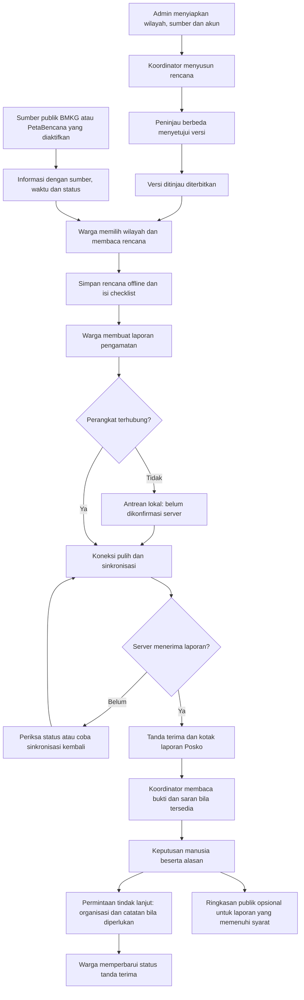

# Tandara — alur aplikasi dan panduan video demonstrasi

Panduan berbahasa Indonesia berdasarkan kode pada branch
`feat/bmkg-warnings-demo-readiness`, diperiksa 13 Oktober 2026.
Nama menu, tombol, status, dan batas fitur dicocokkan dengan implementasi.
Panduan ini tidak membuktikan bahwa deployment publik sudah memakai versi tersebut.

**Alur paling singkat:** warga memilih wilayah, membaca informasi bersumber,
menyimpan rencana lokal dan memeriksa persiapan keluarga. Jika menemukan
hambatan akses, warga membuat laporan dan dapat meminta tindak lanjut komunitas.
Saat offline, laporan menunggu di perangkat. Setelah server menerima laporan,
koordinator meninjau informasi dan mencatat tindak lanjut. Warga melihat
perkembangan melalui tanda terimanya.

**Pesan utama video:** “Tandara membantu warga wilayah rawan bencana
menghubungkan peringatan resmi dengan persiapan keluarga dan koordinasi
hambatan akses, dengan rencana yang dapat disimpan sebelum koneksi terputus.”

## 0. Mengapa sesuai tema sustainability dan subtema lomba?

### 0.1. Fokus masalah dan posisi produk

Subtema yang dijawab adalah **masyarakat di wilayah rawan bencana yang
menghadapi keterlambatan informasi peringatan dan keterbatasan akses evakuasi,
sehingga tidak dapat menyelamatkan dan mempersiapkan diri**.

Posisi produk yang paling kuat adalah **pendukung kesiapsiagaan komunitas dan
koordinasi akses**. Untuk video ini, gunakan satu konteks wilayah rawan banjir
atau cuaca ekstrem yang memang memiliki sumber dan rencana lokal relevan.
Peringatan cuaca BMKG memberi konteks bahaya cuaca; peringatan tersebut tidak
otomatis menyatakan genangan di jalan atau memerintahkan evakuasi.

| Masalah subtema                                       | Respons yang tersedia dalam kode                                                           | Bukti yang ditampilkan                                         | Batas kesimpulan                                                                          |
| ----------------------------------------------------- | ------------------------------------------------------------------------------------------ | -------------------------------------------------------------- | ----------------------------------------------------------------------------------------- |
| Informasi peringatan terlambat atau sulit ditelusuri  | Peringatan CAP BMKG yang diaktifkan, pencocokan wilayah, masa berlaku dan kesehatan sumber | Sumber asli, waktu penerbitan, pengambilan dan keadaan feed    | Belum membuktikan peringatan diterima seluruh warga; aplikasi perlu dibuka dengan koneksi |
| Peringatan belum diikuti persiapan yang jelas         | Tautan dari panel peringatan ke rencana dan checklist                                      | Instruksi lokal, versi, reviewer dan checklist                 | Keterkaitan fitur bukan bukti instruksi sudah dilakukan warga                             |
| Informasi persiapan sulit diakses saat koneksi putus  | Penyimpanan rencana eksplisit dan checklist perangkat                                      | Simpan online, putus koneksi, reload rencana offline           | Tidak mengambil peringatan baru saat offline                                              |
| Titik dan akses evakuasi kurang diketahui             | Titik rencana, catatan aksesibilitas dan informasi akses yang ditinjau lokal               | Catatan yang benar-benar bersumber atau status belum diketahui | Belum menyediakan inventaris shelter terverifikasi, kapasitas atau rute aman saat ini     |
| Hambatan akses tidak sampai ke pengelola              | Kategori Akses terhalang, antrean teks, receipt dan review manusia                         | Satu laporan uji melewati Warga sampai Posko                   | Belum mengatasi jalan rusak atau membuktikan kondisi lapangan                             |
| Kebutuhan tindak lanjut tidak jelas tanggung jawabnya | Permintaan dengan akses terbatas, penugasan organisasi dan catatan status                  | Nama organisasi, alasan dan status tindak lanjut pada receipt  | Penugasan pada aplikasi bukan pengiriman petugas atau keberhasilan evakuasi               |

Penilaian: **kesesuaian konsep kuat; bukti dampak lapangan masih terbatas**.
Bagian informasi sudah memiliki konektor dan transparansi sumber. Bagian akses
evakuasi mendukung pencatatan dan koordinasi, sedangkan ketersediaan fasilitas,
kondisi akses serta bantuan nyata memerlukan pengelola dan validasi lapangan.

### 0.2. Hubungan dengan sustainability yang dapat dipertanggungjawabkan

Pengurangan risiko bencana memiliki tempat dalam pembangunan berkelanjutan.
[SDG 13.1](https://sdgs.un.org/goals/goal13) berfokus pada ketahanan dan
kapasitas adaptasi terhadap bahaya terkait iklim serta bencana;
[SDG 13.3](https://sdgs.un.org/goals/goal13) mencakup pendidikan, kapasitas dan
peringatan dini. Ini mendukung pilihan posisi Tandara sebagai sarana
kesiapsiagaan dan adaptasi komunitas.

[SDG 11.5 dan 11.b](https://sdgs.un.org/goals/goal11) berkaitan dengan dampak
bencana, kelompok rentan dan pengelolaan risiko di permukiman. Keterkaitan
Tandara adalah arah kontribusi: rencana lokal yang dipelihara, informasi akses
dan koordinasi komunitas. Jangan menyebut indikator SDG sudah tercapai karena
fitur tersebut ada.

Kerangka [Early Warnings for All dari WMO](https://wmo.int/resources/wmo-bulletin/wmo-bulletin-vol-72-1-2023/overview-of-early-warnings-all-executive-action-plan-2023-2027)
menghubungkan pengetahuan risiko, pemantauan bahaya, komunikasi peringatan,
serta kesiapan merespons. Tandara mengambil informasi dari lembaga/sumber
eksternal dan mendukung penyajian informasi serta persiapan lokal. Prototipe
ini belum membuktikan seluruh rantai sistem peringatan dini tersebut.

Alasan keberlanjutan yang perlu diterangkan dalam video:

- **Adaptasi:** warga dapat mencari langkah persiapan untuk konteks bahaya
  yang relevan, lalu menyimpan rencana sebelum jaringan terputus.
- **Akses yang lebih inklusif:** rencana dapat memuat keterbatasan akses dan
  kebutuhan pendampingan. Isinya memerlukan pemeriksaan lokal; kolom teks
  aksesibilitas belum membuktikan layanan dapat digunakan semua kelompok.
- **Kapasitas komunitas yang berkelanjutan:** pemilik, peninjau, versi dan
  masa berlaku membuat rencana dapat dipelihara lintas pergantian relawan.
- **Peluang perlindungan kehidupan dan penghidupan:** informasi dan persiapan
  ditujukan untuk mendukung keputusan warga. Hasil pengurangan korban,
  kerugian atau waktu evakuasi baru dapat dinilai melalui penerapan lapangan.

Jika ingin mengaitkan pengelolaan sampah, gunakan sebagai **konteks hambatan
akses/drainase** hanya ketika ada bukti setempat. Catatan material atau sampah
belum membuktikan sampah menyebabkan banjir maupun sudah dibersihkan. Untuk
waktu tersisa tiga hari, pertahankan satu fokus subtema ini dan satu alur kuat.

### 0.3. Perubahan penekanan dalam video

Gunakan pertanyaan pengikat: **“Setelah melihat peringatan, apa yang dapat
disiapkan warga, dan bagaimana hambatan akses diketahui pengelola?”**

Tokoh dalam skenario adalah pengguna uji yang memeriksa rencana keluarga,
membaca catatan akses, lalu melaporkan hambatan contoh. Jangan menciptakan
riwayat korban, kebutuhan disabilitas atau kejadian banjir seolah-olah nyata.
Jika belum ada pengguna lapangan, nyatakan ini demonstrasi prototipe.

Naskah utama di bawah memprioritaskan **laporan hambatan akses dengan
permintaan tindak lanjut**. Karena aksesnya terbatas, laporan ini tidak masuk
ringkasan publik. Adegan ringkasan publik menjadi pilihan terpisah. Peta dan
AI tetap dapat diperagakan, tetapi peringatan, rencana offline, catatan akses
dan tindak lanjut menjadi bukti utama sesuai subtema.

### 0.4. Apa yang diukur sebelum penjurian?

Lakukan 5–10 sesi tugas dengan sukarelawan bila memungkinkan. Jumlah ini usulan
pengujian kecil, bukan jumlah peserta yang sudah ada. Catat siapa pesertanya,
tanggal, perangkat, jaringan dan kegagalan; jangan menyamakan teman tim dengan
masyarakat sasaran. Gunakan tugas hipotetis, tanpa latihan evakuasi berbahaya.

| Ukuran                             | Cara mencatat                                                                                  | Makna yang boleh disebut                                         |
| ---------------------------------- | ---------------------------------------------------------------------------------------------- | ---------------------------------------------------------------- |
| Menemukan instruksi persiapan      | Detik sejak tugas diberikan sampai instruksi relevan ditemukan; tampilkan median dan rentang   | Kemudahan mencari informasi pada uji kecil, bukan waktu evakuasi |
| Memahami sumber                    | Jumlah peserta yang benar membedakan prakiraan, peringatan dan data uji / jumlah yang menjawab | Pemahaman jenis informasi, bukan akurasi prediksi bahaya         |
| Membaca rencana offline            | Jumlah sesi reload offline yang berhasil / jumlah sesi diuji setelah penyimpanan               | Ketahanan akses rencana pada perangkat/jaringan yang diuji       |
| Melaporkan hambatan sampai receipt | Jumlah tugas berhasil / seluruh tugas dicoba; pisahkan waktu offline dari waktu sinkronisasi   | Keberhasilan alur penerimaan platform, bukan kecepatan bantuan   |
| Menemukan catatan akses            | Jumlah peserta menemukan catatan atau mengenali bahwa data belum diketahui / seluruh tugas     | Kemudahan menemukan informasi/kekosongan data                    |
| Mencatat tindak lanjut             | Waktu receipt sampai keputusan/penugasan tercatat selama uji                                   | Waktu proses koordinator dalam uji, bukan respons lapangan       |

Untuk membandingkan dengan cara lama, gunakan sumber pembanding yang benar-benar
dipakai peserta dan tugas setara. Seimbangkan urutan tugas untuk mengurangi
efek belajar. Tanpa pembanding, laporkan hasil absolut, bukan persentase
peningkatan. Timestamp sumber saja tidak mengukur keterlambatan penerimaan
peringatan oleh warga; pengukuran itu memerlukan data penerimaan/pemahaman
peserta yang saat ini belum menjadi bukti deployment.

### 0.5. Prioritas tiga hari dan kaitan penilaian

1. **Hari pertama:** pilih satu wilayah; periksa sumber peringatan, batas
   wilayah dan rencana lokal. Dapatkan informasi titik/akses/kontak dari
   pengelola atau dokumen yang sah, beserta tanggal dan batas informasinya.
   Jangan menghapus label latihan dari data seed tanpa validasi tersebut.
2. **Hari kedua:** reviewer lain meninjau rencana; jalankan sesi tugas kecil
   dan rehearsal offline → receipt → review → tindak lanjut. Jika belum
   mendapatkan mitra lokal, catat kekurangan itu sebagai batas pilot.
3. **Hari ketiga:** uji di domain final, rekam satu alur yang konsisten,
   ringkas hasil pengujian yang benar-benar tersedia dan siapkan penjelasan
   ketika feed kosong. Hindari perubahan fitur besar menjelang rekaman.

| Aspek penilaian                | Penekanan bukti untuk Tandara                                                                                   |
| ------------------------------ | --------------------------------------------------------------------------------------------------------------- |
| Inovasi solusi — 25%           | Hubungan peringatan bersumber → persiapan lokal → laporan hambatan → tindak lanjut manusia                      |
| Implementasi teknis — 30%      | Kesesuaian waktu/wilayah sumber, versi/review rencana, offline reload, receipt dan sinkronisasi tanpa duplikasi |
| Fungsionalitas & desain — 20%  | Tugas warga sederhana, informasi belum diketahui terlihat, perbedaan antrean dan diterima jelas                 |
| Dampak & kelayakan — 15%       | Hasil uji tugas yang sah, data lokal dan pengelola; jelaskan kebutuhan pilot serta biaya/operasi yang tersedia  |
| Presentasi & demonstrasi — 10% | Satu konteks dan alur sebab-akibat, label data nyata/uji, hasil dapat ditelusuri                                |

Tabel ini strategi penyajian berdasarkan bobot yang diberikan tim, bukan
prediksi nilai atau jaminan kemenangan. **Bukti tugas kecil yang jujur dan
rencana lokal yang sah lebih mendukung klaim dampak daripada angka hipotetis.**

Untuk penerapan setelah lomba, kebutuhan terpenting adalah jalur penyampaian
peringatan di luar aplikasi beserta pengukuran penerimaan, inventaris titik
dan akses yang diperbarui pengelola, serta prosedur penanganan permintaan
bersama komunitas. Pengiriman push/SMS/WhatsApp, konfirmasi penerimaan
peringatan oleh warga dan pelacakan petugas lapangan merupakan kebutuhan
lanjutan, bukan bukti fitur saat ini. Proses koordinasi tindak lanjut perlu diuji
bersama organisasi yang benar-benar dapat menanganinya.

## 1. Alur kerja lengkap dalam satu gambar

Diagram menggambarkan urutan kerja, bukan janji kecepatan respons. Koneksi
browser, penerimaan server, peninjauan koordinator, dan tindakan lapangan
merupakan hal yang berbeda.

## 2. Siapa melakukan apa?

| Pihak            | Peran dalam aplikasi                                                                        | Yang terlihat dalam video                                  |
| ---------------- | ------------------------------------------------------------------------------------------- | ---------------------------------------------------------- |
| Warga            | Memilih wilayah, membaca sumber/rencana, menyimpan rencana, checklist, laporan dan tracking | Tandara Warga                                              |
| Koordinator      | Mengakses wilayah yang ditugaskan, meninjau laporan, mengelola rencana dan tindak lanjut    | Tandara Posko                                              |
| Peninjau rencana | Meninjau versi yang ditulis orang lain sebelum penerbitan                                   | Sesi akun berbeda pada Rencana lokal                       |
| Administrator    | Mengatur organisasi, wilayah, akun, sumber dan operasi                                      | Persiapan di belakang layar; tidak perlu mendominasi video |
| Sistem           | Mengambil sumber yang diaktifkan, menyinkronkan laporan dan memproses pekerjaan latar       | Status sumber, antrean dan tanda terima                    |

Warga tidak perlu login ke Posko untuk membuat laporan. Tanda terima disimpan
pada perangkat/browser yang dipakai. Peninjau berbeda tidak harus memiliki
jenis role khusus: yang penting akun berwenang dan bukan penulis versi rencana.

## 3. Tentukan konteks data sebelum merekam

Gunakan **data publik asli untuk informasi**, lalu beri label jelas pada aksi
pengujian yang dibuat khusus untuk video.

| Data yang ditampilkan                               | Sebutan yang tepat                                       |
| --------------------------------------------------- | -------------------------------------------------------- |
| Prakiraan BMKG dari konektor live                   | “Prakiraan cuaca BMKG”, bukan peringatan banjir          |
| CAP BMKG yang cocok dengan wilayah dan masa berlaku | “Peringatan resmi cuaca dari BMKG”                       |
| Laporan live PetaBencana                            | “Laporan urun daya eksternal”, belum ditinjau Tandara    |
| Rencana dan laporan seed                            | “Rencana/laporan latihan”, bukan hasil kegiatan lapangan |
| Laporan contoh yang diketik untuk merekam fitur     | “Uji alur pelaporan”, bukan insiden nyata                |
| Rekaman atau snapshot sumber pada tanggal terdahulu | “Arsip/rekaman bertanggal”, bukan kondisi terkini        |

Mengaktifkan BMKG tidak membuat batas wilayah ilustratif, titik kumpul contoh,
atau rencana seed menjadi data lapangan. Bila ingin seluruh video memakai data
nyata, gunakan rencana bersumber dan ditinjau serta laporan yang memang ada
dengan izin yang sesuai. Jika laporan nyata belum tersedia, tampilkan inbox
kosong atau pisahkan adegan uji. Jangan mengarang insiden untuk mengisi dashboard.

## 4. Persiapan perekaman

Selesaikan persiapan ini sebelum menekan tombol rekam:

1. **Buka versi aplikasi yang sesuai.** Panel `Peringatan resmi & langkah
kesiapsiagaan` harus ada jika segmen BMKG baru akan diperagakan. Jika belum
   dirilis, gunakan build lokal yang sesuai atau selesaikan deployment terlebih
   dahulu. Jangan mengaku fitur telah berjalan di domain publik hanya karena
   sudah ada di repository.
2. **Siapkan dua tampilan:** Warga dan Posko. Untuk segmen persetujuan rencana,
   siapkan sesi peninjau lain dalam profil browser berbeda. Warga utama sebaiknya
   memakai browser biasa agar rencana dan receipt tetap tersimpan.
3. **Login Posko sebelum merekam.** Jika seed masih dipakai, contoh akun adalah
   `ciliwung@demo.tandara.test` dan `admin@demo.tandara.test`. Pakai password
   yang benar-benar dikonfigurasi operator; password tidak ditulis dalam naskah.
4. **Pilih wilayah yang sama** di Warga dan Posko. Pastikan akun koordinator
   memang ditugaskan ke wilayah itu.
5. **Periksa sumber live.** Konektor perlu diaktifkan dan berhasil diperbarui.
   Jangan menyimpulkan sumber aktif hanya dari URL dokumentasi atau tombol
   refresh. Langkah aktivasi ada di [runbook sumber publik](../operations/public-sources.md).
6. **Siapkan satu rencana terbit yang masih berlaku.** Jika hanya rencana
   latihan tersedia, pertahankan labelnya. Periksa instruksi, checklist dan
   catatan akses sebelum menentukan langkah yang disebut dalam narasi.
   Pastikan organisasi penerima tindak lanjut sesuai wilayah demo.
7. **Uji offline pada build produksi/PWA.** Muat Warga online, simpan rencana,
   tunggu service worker siap, lalu uji reload offline. Dev server Vite saja
   tidak cukup sebagai bukti app shell tetap dapat dibuka offline.
8. **Periksa mode triase/AI.** Compose demo memakai `heuristic` secara default.
   Dalam mode itu, UI menyebut aturan kata kunci deterministik. Nama provider
   dan model hanya disebut jika cocok dengan provenance hasil yang ditampilkan.
9. **Rehearsal satu laporan uji.** Pastikan antrean berubah menjadi tanda terima,
   laporan bisa dicari di Posko dan status hasil review terlihat di Warga.
10. **Hindari data pribadi di rekaman.** Jangan membuka token privat pada receipt,
    password, MFA, cookies, Secrets, kontak warga atau foto pribadi. Jangan
    membersihkan storage browser di tengah demo: rencana dan receipt dapat hilang.

Alamat menggunakan deployment yang benar-benar tersedia. Untuk full Compose
lokal, Warga default di `http://127.0.0.1:8080` dan Posko di
`http://127.0.0.1:8081`. Domain publik mengikuti konfigurasi operator, bukan
asumsi naskah. Jangan mencampur alamat: storage offline terpisah per origin.

## 5. Susunan video utama — target lima menit

Durasi ini panduan penyuntingan, bukan batas waktu proses aplikasi. Bila harus
menunggu jaringan/worker, potong jeda dengan caption **“Setelah sinkronisasi”**
atau **“Setelah ditinjau”**, tanpa mengubah urutan sebab-akibat.

| Waktu       | Adegan                              | Bukti yang perlu terlihat                                         |
| ----------- | ----------------------------------- | ----------------------------------------------------------------- |
| 00:00–00:25 | Masalah dan pengenalan dua aplikasi | Warga dan Posko; satu wilayah fokus                               |
| 00:25–01:05 | Informasi bersumber                 | Jenis sumber, waktu, cakupan atau keadaan kosong                  |
| 01:05–01:45 | Rencana dan persiapan               | Reviewer/masa berlaku, catatan akses, simpan offline, checklist   |
| 01:45–02:30 | Offline dan laporan uji             | Reload rencana offline; antrean belum diterima server             |
| 02:30–02:55 | Koneksi kembali                     | Receipt `Diterima platform` setelah konfirmasi                    |
| 02:55–03:50 | Peninjauan dan tindak lanjut Posko  | Laporan asli, keputusan, alasan dan organisasi penanggung jawab   |
| 03:50–04:25 | Hasil kembali ke warga              | Status tinjauan dan status tindak lanjut pada receipt             |
| 04:25–05:00 | Manfaat dan batas penerapan         | Alur persiapan/koordinasi, rencana pengukuran atau hasil yang sah |

### Adegan 1 — masalah dan pengenalan

**Gerakan layar:** tampilkan Beranda Warga, lalu cuplikan singkat Posko.

**Narasi siap dibaca:**

> Subtema kami berangkat dari keterlambatan informasi peringatan dan keterbatasan
> akses evakuasi di wilayah rawan bencana. Tandara membantu menghubungkan
> peringatan bersumber dengan rencana persiapan warga, lalu membawa laporan
> hambatan akses ke Posko untuk ditinjau dan dicatat tindak lanjutnya.

**Caption:** `Tandara Warga ↔ Tandara Posko`.

Ini pengantar masalah yang dipilih tim, bukan klaim hasil penelitian bahwa
seluruh masyarakat mengalami keadaan yang sama.

### Adegan 2 — memilih wilayah dan membaca sumber

**Langkah layar:**

1. Di Beranda Warga, pilih **Wilayah** yang akan dipakai sepanjang video.
2. Tampilkan panel **Peringatan resmi & langkah kesiapsiagaan**.
3. Jika ada peringatan yang sesuai, sorot waktu penerbitan, masa berlaku,
   cakupan dan tautan **Baca dokumen peringatan asli BMKG**.
4. Bila memakai prakiraan, buka **Informasi wilayah** dan detail
   **Sumber dan riwayat waktu**. Perhatikan nama kelurahan dan periode prakiraan.

**Narasi umum:**

> Warga memilih wilayah, lalu melihat sumber, waktu dan cakupan informasi.
> Prakiraan cuaca berbeda dari peringatan resmi. Dari panel peringatan, warga
> dapat membuka rencana lokal dan memeriksa persiapan keluarga.

**Jika peringatan tersedia, tambahkan:**

> Peringatan ini berasal dari BMKG. Cakupannya dicocokkan dengan batas wilayah
> yang diatur pengelola, dan masa berlakunya tetap terlihat.

**Jika feed sehat tetapi kosong, gunakan:**

> Pada pengambilan ini, tidak ada peringatan BMKG yang cocok dan masih berlaku
> untuk wilayah tersebut. Itu tidak berarti wilayah aman. Warga tetap dapat
> membaca sumber resmi dan menyiapkan rencana lokal.

**Jika sumber belum terkonfirmasi:**

> Pembaruan sumber belum terkonfirmasi. Aplikasi memperlihatkan keadaan ini
> agar pengguna memeriksa kanal resmi sebelum menyimpulkan kondisi wilayah.

Jeda terbit→pengambilan terakhir adalah waktu sumber dibanding pengambilan
server, bukan bukti semua warga menerima pesan pada waktu itu.

### Adegan 3 — rencana dan checklist

**Langkah layar:**

1. Klik **Baca & simpan rencana offline**, atau menu **Rencana**.
2. Sorot judul, pemilik, versi, reviewer, tanggal tinjauan dan masa berlaku.
3. Tunjukkan satu instruksi, **Titik pertemuan & fasilitas** serta catatan
   **Akses** yang memang tersedia. Jika ada, sorot
   **Informasi akses yang ditinjau lokal**. Jika belum ada data, jelaskan
   kekosongannya; jangan menggantinya dengan perkiraan kondisi jalan.
4. Klik **Simpan offline**. Tunggu pesan bahwa rencana tersimpan di perangkat.
5. Buka **Checklist**, lalu centang satu item yang ada pada rencana tersebut.

**Narasi:**

> Persiapan memerlukan rencana yang sesuai kondisi setempat. Di sini warga
> membaca instruksi, titik referensi dan catatan akses yang tersedia, termasuk
> keterbatasan yang perlu diperiksa bersama pengelola. Rencana memiliki peninjau
> dan masa berlaku, lalu dapat disimpan sebelum koneksi terputus.

Jika rencana berlabel **Simulasi**, beri caption `Rencana latihan` dan sebutkan
konteks itu. Jangan menyebut titik latihan sebagai shelter resmi. Progress
checklist adalah centang pada perangkat, bukan pengukuran kesiapan semua keluarga.

### Adegan 4 — membuktikan offline dan membuat laporan uji

**Langkah layar:**

1. Kembali ke **Rencana** yang sudah disimpan.
2. Putus jaringan Warga saja, misalnya melalui mode offline DevTools. Pastikan
   status perangkat berubah; membiarkan halaman yang sudah terbuka belum
   membuktikan offline access.
3. **Reload halaman.** Rekam rencana tetap terbaca dan pesan
   **Menggunakan data tersimpan**. Checklist yang disimpan juga dapat dibuka.
4. Buka **Laporan**, pilih **Jenis laporan → Akses terhalang** jika kategori
   tersebut tersedia pada wilayah.
5. Masukkan data contoh di bawah, setujui penggunaan/penyimpanan data dan klik
   **Simpan laporan offline**.
   Centang **Saya membutuhkan tindak lanjut komunitas** untuk alur utama ini;
   tidak perlu memasukkan kontak pribadi.
6. Di **Laporan saya**, tampilkan **Antrean di perangkat** dengan status
   **Menunggu koneksi · belum dikonfirmasi server**.

**Input khusus uji video:**

| Field                    | Isi                                                                                                              |
| ------------------------ | ---------------------------------------------------------------------------------------------------------------- |
| Apa yang Anda amati?     | `UJI VIDEO TANDARA: contoh laporan akses terhalang di dekat titik latihan. Kondisi lapangan belum dikonfirmasi.` |
| Patokan lokasi           | `Titik latihan — contoh untuk demonstrasi`                                                                       |
| Waktu pengamatan         | Kosong, karena ini contoh alur dan bukan pengamatan insiden nyata                                                |
| GPS, foto dan kontak     | Tidak diisi                                                                                                      |
| Permintaan tindak lanjut | Dicentang: ini uji koordinasi hambatan akses; detail tidak menjadi ringkasan publik                              |

**Narasi:**

> Rencana yang sudah disimpan tetap terbaca saat koneksi terputus. Sekarang
> kami menguji laporan hambatan akses dan permintaan tindak lanjut komunitas.
> Contoh ini bukan kejadian nyata. Saat offline, laporan menunggu di perangkat
> dan belum diterima Posko.

**Caption:** `Data uji video · belum diterima server`.

Offline tidak menyediakan peringatan baru, peta jalan live, pencarian sumber
terkini atau layanan Posko. Draf offline tidak menyimpan GPS, foto dan kontak.

### Adegan 5 — sinkronisasi dan tanda terima

**Langkah layar:**

1. Kembalikan jaringan Warga ke online.
2. Sistem mencoba sinkronisasi; jika perlu, di **Laporan saya** klik
   **Sinkronkan antrean**.
3. Tunggu kartu dengan badge **Diterima platform**. Status awal laporan yang
   diterima adalah **Menunggu tinjauan**.
4. Jangan membuka bagian token privat pada **Riwayat status & tanda terima**
   untuk rekaman publik.

**Narasi:**

> Ketika koneksi kembali dan server menerima laporan, warga mendapatkan tanda
> terima untuk memantau prosesnya. Diterima platform berarti laporan tercatat,
> belum berarti kondisi sudah dikonfirmasi atau bantuan telah dikirim.

Jangan menyamakan pesan “Sinkronisasi selesai” dengan penerimaan semua draf.
Badge dan status pada kartu laporan merupakan bukti yang harus ditunjukkan.

### Adegan 6 — peninjauan oleh koordinator

**Langkah layar:**

1. Di Posko, pilih wilayah yang sama, lalu buka **Kotak laporan**.
2. Isi pencarian **Cari teks / patokan** dengan `UJI VIDEO TANDARA`, klik **Cari**,
   dan buka laporan yang barusan diterima.
3. Sorot **Laporan asli** serta waktu/koordinat yang belum diketahui.
4. Tampilkan **Asisten triase** jika hasil tersedia. Gunakan narasi mode yang
   sesuai pada bagian berikut; jangan menunggu AI untuk meninjau laporan.
5. Pada **Keputusan koordinator**, pilih **Status tujuan → Ditinjau koordinator**.
6. Isi **Alasan keputusan** di bawah. Pada laporan yang meminta tindak lanjut,
   ringkasan publik tidak tersedia.
7. Klik **Simpan keputusan manusia**, tunggu berhasil dan sorot riwayatnya.
8. Klik **Buka antrean tindak lanjut**, atau menu **Tindak lanjut**; cocokkan
   ID laporan tadi. Pilih organisasi wilayah
   pada **Penanggung jawab**, lalu **Status tindak lanjut → Ditugaskan**.
9. Isi **Catatan tindak lanjut** dan klik **Simpan tindak lanjut**. Jangan
   memilih status selesai untuk menggambarkan pekerjaan lapangan yang belum ada.

**Alasan keputusan contoh:**

> Uji alur video: isi contoh telah dibaca koordinator. Waktu pengamatan dan
> koordinat tidak tersedia. Ini bukan konfirmasi adanya kejadian lapangan.

**Catatan tindak lanjut contoh:**

> Uji video: organisasi komunitas dicatat sebagai penanggung jawab pemeriksaan
> informasi akses. Tidak ada petugas yang dikirim dan kondisi lapangan belum
> dikonfirmasi.

**Narasi utama:**

> Koordinator membaca laporan asli dan menandai informasi yang belum diketahui.
> Keputusan serta alasannya dicatat manusia. Permintaan tindak lanjut dapat
> diberi organisasi penanggung jawab dan catatan, agar proses koordinasi
> terlihat. Pencatatan ini belum berarti bantuan sudah dikirim.

**Kalimat tambahan sesuai keadaan layar:**

| Keadaan                                                            | Kalimat yang digunakan                                                                        |
| ------------------------------------------------------------------ | --------------------------------------------------------------------------------------------- |
| UI menyebut aturan kata kunci deterministik                        | “Pada mode ini, saran memakai aturan kata kunci; bukan inferensi model AI.”                   |
| Provider AI benar-benar menghasilkan hasil dan provenance tersedia | “Model membantu menyusun saran dari informasi yang diberikan; hasilnya tetap perlu ditinjau.” |
| Hasil menunggu/gagal/tidak tersedia                                | “Koordinator tetap dapat meninjau laporan saat saran belum tersedia.”                         |

Tombol **Terima saran** menerima saran triase, bukan keputusan laporan. Untuk
mengubah status laporan, tetap gunakan **Simpan keputusan manusia**.
Untuk data uji, status ditinjau berarti contoh telah diperiksa dalam demo;
jangan mengatakan kejadian telah diverifikasi di lapangan.

### Adegan 7 — hasil kembali kepada warga

**Langkah layar:**

1. Kembali ke **Laporan saya** di browser Warga yang menyimpan receipt tadi.
2. Klik **Perbarui status** pada kartu laporan.
3. Sorot **Ditinjau koordinator**.
4. Sorot **Status tindak lanjut komunitas: assigned** jika langkah penugasan
   tadi berhasil. UI saat ini memakai nilai status teknis tersebut; narasikan
   sebagai “ditugaskan”, tanpa mengklaim petugas sudah bergerak.

**Narasi:**

> Warga melihat status tinjauan dan pencatatan tindak lanjut melalui tanda
> terima. Permintaan ini memiliki akses terbatas. Warga dapat mengetahui
> perkembangan proses, tanpa menganggapnya sebagai konfirmasi layanan darurat.

Laporan utama ini tidak muncul pada ringkasan publik Beranda. Jika ingin
menampilkan **Kabar komunitas yang telah ditinjau**, gunakan laporan uji lain
tanpa permintaan tindak lanjut, isi ringkasan saat review dan pertahankan label
uji. Jangan membuka data permintaan pribadi untuk mengisi adegan publik.

### Adegan 8 — manfaat dan penutup

**Gerakan layar:** tutup dengan rencana/checklist Warga dan keputusan Posko,
atau diagram alur sederhana. Hindari menampilkan terminal deployment.

**Narasi:**

> Kontribusi sustainability yang kami bangun adalah kesiapsiagaan dan ketahanan
> komunitas menghadapi bencana. Tandara menghubungkan peringatan bersumber,
> rencana yang dapat disimpan, serta koordinasi hambatan akses. Langkah
> berikutnya adalah memvalidasi informasi bersama pengelola lokal dan mengukur
> kemampuan warga menjalankan alur persiapan ini.

Jika sudah memiliki hasil pengujian sukarelawan yang nyata, ganti bagian akhir
dengan jumlah peserta, tugas, hasil dan keterbatasannya. Jika belum, gunakan
narasi rencana pengukuran tersebut. Hindari angka pengurangan risiko, nyawa
terselamatkan atau emisi yang belum diukur.

## 6. Segmen tambahan — pilih sesuai durasi

Alur utama sudah cukup untuk video lima menit. Segmen berikut dapat digunakan
sebagai pengganti bagian yang kurang relevan atau untuk versi enam–tujuh menit.

### A. Peta situasi — 20–30 detik

Buka **Peta situasi** di Posko. Tunjukkan **Peta dasar**, **Laporan warga**,
**Titik rencana** dan **Cakupan informasi** sesuai data yang benar-benar ada.
Pertahankan atribusi OpenStreetMap. Laporan uji tanpa koordinat tidak boleh
ditunjukkan sebagai marker yang lokasinya ditebak dari patokan teks.

> Peta membantu koordinator membaca konteks lokasi dan cakupan informasi.
> Laporan tanpa koordinat tetap membutuhkan pemeriksaan. Wilayah yang belum
> memiliki cukup laporan tidak dapat dianggap aman.

Peta jalan tidak menetapkan jalur evakuasi aman. Titik rencana adalah referensi
rencana lokal, bukan bukti fasilitas buka atau dapat dicapai saat ini.

### B. Rencana yang ditinjau dua orang — 30–45 detik

Siapkan draf sebelum merekam agar tidak menghabiskan waktu mengetik:

1. Penulis membuka **Rencana lokal → Buat draf baru**, mengisi konten dan
   alasan, lalu **Simpan draf**.
2. Penulis mengisi **Alasan tindakan rencana**, lalu **Minta tinjauan**.
3. Akun berwenang yang berbeda membuka versi tersebut, mengisi alasan dan
   memilih **Setujui versi**.
4. Setelah status `approved`, pilih **Terbitkan versi ditinjau**.
5. Muat ulang Warga untuk menunjukkan versi `published` yang berlaku.

> Perubahan rencana melewati penulis dan peninjau berbeda. Versi yang
> diterbitkan dapat dibaca warga, dengan riwayat tinjauan dan masa berlakunya.

State yang dapat muncul adalah `draft`, `in_review`, `changes_requested`,
`approved`, `published` dan `archived`. Persetujuan saja belum menerbitkan
rencana. Versi offline lama tidak berubah diam-diam: warga perlu menyimpan
ulang rencana terbaru.

### C. Asisten Posko berbasis sumber — 45–60 detik

Peragakan hanya jika mode, izin, sumber disetujui, worker dan anggaran sudah
siap. Referensi harus bertanggal, memiliki URL/izin penggunaan dan ditinjau
orang berbeda. Jangan mengubah provider atau memakai data pribadi demi video.

1. Buka **Asisten Posko → Jenis bantuan → Tanya rencana disetujui**.
2. Ajukan pertanyaan yang jawabannya memang ada dalam sumber, misalnya
   “Apa yang perlu disiapkan menurut rencana ini?”
3. Klik **Buat draf bantuan** sekali. Ikuti `Dalam antrean` → `Sedang diproses`
   → `Perlu tinjauan` jika run berhasil; jangan menjanjikan durasi atau kalimat hasil.
4. Buka sumber/kutipan dan **Asal hasil dan riwayat**.
5. Setelah membandingkan dengan sumber, isi **Catatan keputusan** dan klik
   **Terima sebagai draf** jika memang layak diterima.

> Asisten membantu koordinator membaca sumber yang disetujui dan menyusun
> draf dengan kutipan. Koordinator memeriksa sumber sebelum menerima hasilnya.
> Penerimaan ini belum menerbitkan rencana atau mengirim bantuan.

Jika hasil tidak menemukan bukti yang cukup, tunjukkan keadaan itu. Jika
memakai hasil dari run terdahulu, beri caption `Hasil run sebelumnya`.
Nama Vikey, DeepSeek atau Gemini hanya disebut bila konfigurasi/provenance
yang diperagakan mendukungnya. Compose demo default tidak membuktikan model
live tersebut aktif.

Pencarian **Cari rencana** pada Warga mengembalikan petikan sumber asli;
jangan menyebutnya chatbot atau menyamakan layar ini dengan jawaban generatif.

### D. Tindak lanjut komunitas — 20–30 detik

Bagian ini sudah masuk alur utama. Untuk cuplikan tersendiri, gunakan laporan
uji dengan permintaan tindak lanjut. Di Posko buka
**Tindak lanjut**, isi **Penanggung jawab**, **Status tindak lanjut** dan
**Catatan tindak lanjut**, lalu **Simpan tindak lanjut**. Gunakan data contoh
tanpa nomor pribadi. Status yang tersimpan dapat tampil sebagai `received`,
`assigned`, `in_progress` atau `closed`; label pilihan di form diterjemahkan.

> Permintaan tindak lanjut memiliki akses terbatas dan penanggung jawab
> komunitas. Status ini mencatat proses koordinasi, bukan bukti petugas darurat
> sudah dikirim atau telah tiba di lokasi.

## 7. Kalimat yang akurat untuk dipakai

| Kalimat yang perlu diperbaiki                 | Kalimat yang sesuai implementasi                                                                     |
| --------------------------------------------- | ---------------------------------------------------------------------------------------------------- |
| “Tandara memprediksi banjir.”                 | “Tandara menampilkan informasi bersumber dan membantu kesiapsiagaan lokal.”                          |
| “Aplikasi menerbitkan peringatan resmi.”      | “Aplikasi meneruskan peringatan cuaca resmi dari BMKG ketika sumber diaktifkan dan datanya sesuai.”  |
| “Warga otomatis menerima notifikasi darurat.” | “Warga membaca informasi di aplikasi; pengiriman push/SMS/WhatsApp belum menjadi bukti demo ini.”    |
| “Semua fitur berjalan tanpa internet.”        | “Rencana yang disimpan, checklist lokal dan antrean laporan teks dapat digunakan offline.”           |
| “Laporan offline sudah dikirim.”              | “Laporan menunggu di perangkat sampai server mengonfirmasi penerimaan.”                              |
| “AI memverifikasi kondisi lapangan.”          | “Saran mendukung peninjauan; keputusan tetap dicatat koordinator.”                                   |
| “Ditinjau berarti sudah aman.”                | “Ditinjau merupakan status proses laporan, bukan jaminan keselamatan.”                               |
| “Titik kumpul dan jalur ini aman.”            | “Rencana memuat referensi titik dan catatan akses yang perlu diperiksa sesuai keadaan.”              |
| “Checklist 100% berarti keluarga pasti siap.” | “Checklist mencatat persiapan yang dicentang pada perangkat.”                                        |
| “Sampah berkurang sekian ton.”                | “Laporan material/sampah dapat menjadi informasi tindak lanjut; dampak fisiknya masih perlu diukur.” |

## 8. Checklist hasil rekaman

- [ ] Satu wilayah dipakai konsisten di Warga dan Posko.
- [ ] Label sumber asli, arsip, latihan dan uji terbaca.
- [ ] Kondisi feed pada saat rekaman ditampilkan apa adanya.
- [ ] Nomor versi, reviewer dan masa berlaku rencana tampak.
- [ ] Offline dibuktikan dengan reload setelah rencana disimpan.
- [ ] Antrean lokal dan receipt server ditampilkan sebagai dua keadaan berbeda.
- [ ] Teks laporan asli sama dengan contoh yang dicari di Posko.
- [ ] Mode aturan kata kunci/model AI disebut sesuai layar.
- [ ] Keputusan manusia beserta alasan dan status akhir terlihat.
- [ ] Catatan akses relevan dengan rencana; ketidaktersediaan data dijelaskan.
- [ ] Permintaan tindak lanjut dan organisasi penanggung jawab terlihat tanpa klaim bantuan dikirim.
- [ ] Kaitannya dengan sustainability dijelaskan melalui kesiapsiagaan dan ketahanan komunitas.
- [ ] Jika segmen ringkasan publik dipakai, gunakan laporan uji terpisah dan label uji tetap terlihat.
- [ ] Token privat, password, MFA, cookies dan kontak pribadi tidak masuk video.
- [ ] Tidak ada klaim rute aman, dispatch, penerimaan peringatan semua warga atau dampak yang belum diukur.
- [ ] Caption jeda menjelaskan urutan kejadian tanpa berpura-pura proses instan.

## 9. Dasar verifikasi dan referensi

Panduan ini menggantikan naskah lama sebagai acuan video singkat dengan sumber
publik asli dan aksi uji yang dipisahkan. Naskah lama
[demo-flow.md](demo-flow.md) menggambarkan demonstrasi simulasi lebih panjang
dan konfigurasi provider tertentu, sehingga tidak semua narasinya cocok untuk
deployment demo default saat ini.

| Bagian                                                          | Sumber yang diperiksa                                                                                                    |
| --------------------------------------------------------------- | ------------------------------------------------------------------------------------------------------------------------ |
| Menu Warga, rencana, checklist, peringatan dan offline fallback | `apps/resident-web/src/features/resident-app.tsx`                                                                        |
| Form laporan, antrean, receipt dan tombol status                | `apps/resident-web/src/features/resident-workflows.tsx`, `apps/resident-web/src/offline/sync.ts`                         |
| Menu dan akses Posko                                            | `apps/coordinator-web/src/features/posko-app.tsx`                                                                        |
| Saran triase dan keputusan manusia                              | `apps/coordinator-web/src/features/reports-ui.tsx`, `packages/backend/src/modules/reports.ts`                            |
| Rencana, sumber dan tindak lanjut                               | `apps/coordinator-web/src/features/management-ui.tsx`, `packages/backend/src/modules/preparedness.ts`                    |
| Draf AI dan sumber pengetahuan                                  | `apps/coordinator-web/src/features/ai-ui.tsx`, `knowledge-ui.tsx`, `apps/resident-web/src/features/knowledge-search.tsx` |
| Mode default deployment                                         | `infrastructure/deployment/backend.compose.yml`                                                                          |
| Pengujian alur                                                  | `tests/e2e/product.spec.ts`, `tests/e2e/public-sources.spec.ts`, [QA sumber publik](../qa/public-sources-2026-10-13.md)  |

Verifikasi pada pembuatan panduan berupa pembacaan kode/dokumen dan pemeriksaan
nama aksi. Tidak ada klaim bahwa seluruh alur publik telah direkam ulang pada
domain akhir. Selalu lakukan satu rehearsal pada versi dan akun yang akan dipakai.
